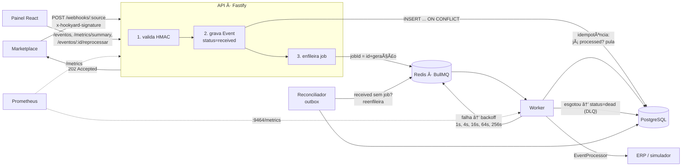
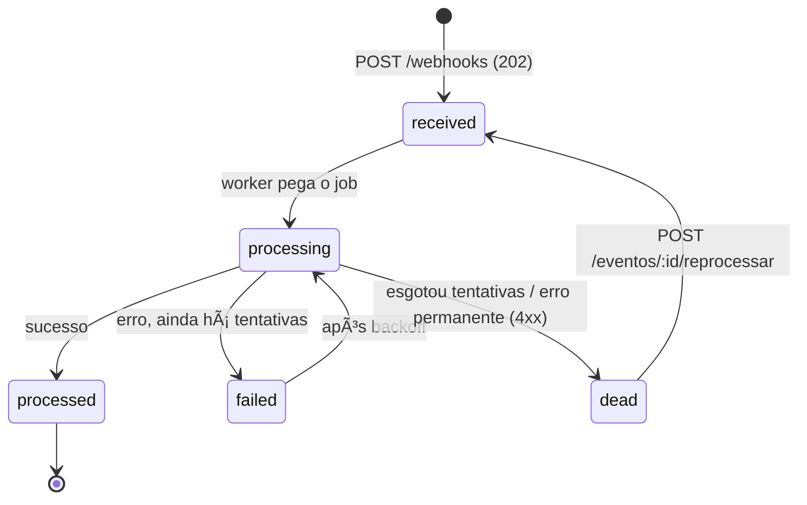

# HookYard

> Receptor de webhooks com fila, retry exponencial, dead-letter queue e painel de observabilidade.
> O "pátio de manobras" entre o marketplace e o ERP.

Webhook de marketplace não espera: se o endpoint demora ou cai, o evento é perdido ou reenviado em duplicidade. Integrações ingênuas processam o pedido **dentro** do request HTTP — e quando o ERP fica lento, o marketplace recebe timeout e a operação vira incidente.

O HookYard separa **receber** de **processar**:

1. `POST /webhooks/:source` valida a assinatura HMAC, grava o evento e responde `202` em milissegundos.
2. Um worker consome a fila e processa com retry exponencial + jitter; após N tentativas, move para a DLQ.
3. Idempotência por `eventId`: reentrega do mesmo evento não duplica efeito.
4. Um painel web lista eventos, status, tentativas e payload, e permite reprocessar itens da DLQ.


## Arquitetura



Ciclo de vida de um evento:



### Padrões aplicados

| Padrão | Onde | Por quê |
|---|---|---|
| **Persistir antes de enfileirar (outbox)** | `routes/webhooks.ts`, `worker/reconciler.ts` | Se o Redis estiver fora, o POST ainda responde 202 e o evento fica `received`. O reconciliador acha eventos `received` sem job e os reenfileira. |
| **Idempotency key no banco** | `UNIQUE (source, event_id)` + `INSERT … ON CONFLICT DO NOTHING` | Requisições concorrentes com o mesmo `eventId` geram um único registro (há teste com 10 POSTs em paralelo). |
| **Idempotência no consumo** | `markProcessing` só transiciona a partir de `received/processing/failed` | Processamento *at-least-once* com efeito *exactly-once*: um job entregue duas vezes não reprocessa evento `processed`. |
| **jobId determinístico** | `jobIdFor(event)` = `id` + `updated_at` | Enfileirar duas vezes o mesmo evento (API + reconciliador) não duplica o job; reprocessar gera uma nova "geração". |
| **Strategy de processador** | `EventProcessor` → `SimulatedProcessor`, `HttpProcessor` | O worker não sabe se fala com ERP real ou simulador. Facilita demo e teste. |
| **Backoff puro e testável** | `computeDelay(attempt, opts, random)` | Função pura, RNG injetável → testes determinísticos do jitter. |
| **Erros permanentes** | `PermanentProcessingError` (ex.: ERP responde 422) | Não adianta tentar 5x um payload inválido: vai direto para a DLQ. |
| **Graceful shutdown** | `worker.close()` no SIGTERM | Para de pegar jobs novos e espera os em andamento terminarem. |

### Backoff exponencial com jitter

```
delay(n) = min(base × fatorⁿ⁻¹, teto) × (1 ± jitter)
```

Com os padrões (`base=1s`, `fator=4`, `jitter=±20%`) as novas tentativas acontecem após ~**1s, 4s, 16s, 64s, 256s**. O jitter evita a *thundering herd*: quando o ERP volta, milhares de eventos que falharam juntos não tentam de novo no mesmo milissegundo. O cálculo é registrado no BullMQ como estratégia customizada (`settings.backoffStrategy`), então o agendamento sobrevive a restart do worker.

## Rodando

Requisitos: Docker (com Compose) e, para desenvolvimento, Node 22 + pnpm 10.

```bash
docker compose up --build
```

| Serviço | URL |
|---|---|
| Painel | http://localhost:8080 |
| API | http://localhost:3000 |
| Métricas da API | http://localhost:3000/metrics |
| Métricas do worker | http://localhost:9464/metrics |

Gerando tráfego de demonstração (assinado com os segredos de dev do compose):

```bash
pnpm install
pnpm demo                                  # 20 pedidos; ~30% falham na 1ª tentativa (SIMULATED_FAILURE_RATE)
pnpm demo --scenario retry                 # falha 2x e sucede na 3ª
pnpm demo --scenario dlq                   # sempre falha → DLQ
pnpm demo --scenario dlq-then-recover      # esgota as 5 tentativas; "Reprocessar" no painel conclui na 6ª
pnpm demo --duplicate --source shopee      # reenvia o mesmo eventId → um único registro
```

Enviando um webhook manualmente:

```bash
BODY='{"id":"pedido-123","type":"order.created","data":{"total":199.9}}'
SIG="sha256=$(printf '%s' "$BODY" | openssl dgst -sha256 -hmac dev-secret-mercadolivre | awk '{print $2}')"
curl -i localhost:3000/webhooks/mercadolivre -H 'content-type: application/json' -H "x-hookyard-signature: $SIG" -d "$BODY"
```

### Desenvolvimento local

```bash
cp .env.example .env
docker compose up -d postgres redis
pnpm install
pnpm migrate
pnpm dev:api      # :3000
pnpm dev:worker   # :9464
pnpm dev:web      # :5173 (proxy /api → :3000)
```

### Configuração

| Variável | Padrão | Descrição |
|---|---|---|
| `WEBHOOK_SECRET_<SOURCE>` | — | Segredo HMAC por source. `WEBHOOK_SECRET_MERCADO_LIVRE` habilita `/webhooks/mercado-livre`. |
| `MAX_ATTEMPTS` | `5` | Tentativas antes da DLQ. |
| `BACKOFF_BASE_MS` / `BACKOFF_FACTOR` / `BACKOFF_JITTER` / `BACKOFF_MAX_MS` | `1000` / `4` / `0.2` / `900000` | Parâmetros do backoff. |
| `WORKER_CONCURRENCY` | `5` | Jobs simultâneos por worker. |
| `RECONCILE_INTERVAL_MS` / `RECONCILE_MIN_AGE_MS` | `30000` / `10000` | Frequência do reconciliador e idade mínima de um órfão. |
| `PROCESSOR` | `simulated` | `simulated` ou `http`. |
| `SIMULATED_FAILURE_RATE` / `SIMULATED_LATENCY_MS` | `0.3` / `200` | Comportamento do ERP simulado. |
| `PROCESSOR_HTTP_URL` / `PROCESSOR_HTTP_TIMEOUT_MS` | — / `5000` | Destino do `HttpProcessor` (envia `idempotency-key`). 5xx/408/429 → retry; demais 4xx → DLQ. |

O payload pode trazer `"simulate": { "failAttempts": 2 }`, `{ "alwaysFail": true }` ou `{ "latencyMs": 3000 }` para demos reproduzíveis com o processador simulado.

## API

| Método | Rota | Descrição |
|---|---|---|
| `POST` | `/webhooks/:source` | Recebe o webhook. Corpo JSON com `id` e `type` (o resto vira payload). Header `x-hookyard-signature: sha256=<hmac hex do corpo cru>`. **202** aceito · **200** duplicado já processado · **401** assinatura inválida · **404** source desconhecida · **400** corpo inválido. |
| `GET` | `/eventos` | Lista com filtros `status`, `source`, `from`, `to` (ISO 8601), `limit`, `offset`. |
| `GET` | `/eventos/:id` | Detalhe com payload e `attemptHistory` (início, duração, erro de cada tentativa). |
| `POST` | `/eventos/:id/reprocessar` | Reenfileira item da DLQ. **409** se o evento não está `dead`. |
| `GET` | `/metrics` | Prometheus: recebidos, processados, falhas, DLQ, tamanho da fila, eventos por status, histogramas de latência. |
| `GET` | `/metrics/summary` | Resumo JSON usado pelo painel. |
| `GET` | `/health/live` · `/health/ready` | Liveness (processo de pé) e readiness (Postgres + Redis respondendo, com timeout). |

## Testes

```bash
pnpm test             # unit + integração (Testcontainers sobe Postgres e Redis)
pnpm test:coverage    # com relatório de cobertura (limite: 85%)
pnpm test:unit        # sem Docker
```

Sem Docker disponível, aponte para serviços existentes com `TEST_DATABASE_URL` e `TEST_REDIS_URL`.

Os testes provam o comportamento **sob falha**, não só no caminho feliz:

| Arquivo | O que prova |
|---|---|
| `unit/backoff.test.ts` | Progressão 1s→256s, jitter com RNG fixo, teto, entradas inválidas. |
| `unit/hmac.test.ts` | Assinatura válida / inválida / ausente / adulterada / truncada. |
| `unit/idempotency.test.ts`, `unit/event-handler.test.ts` | Decisão de idempotência, retry vs. DLQ, erro permanente, métricas. |
| `integration/receive.test.ts` | 202 rápido e evento persistido antes do job; duplicado não cria registro nem reprocessa; 10 POSTs concorrentes → 1 registro; Redis fora → ainda 202. |
| `integration/retry.test.ts` | Processador falha 2x e sucede na 3ª, com intervalos ≥ delays calculados. |
| `integration/dlq.test.ts` | Esgota tentativas → `dead` com stack; aparece em `/eventos?status=dead`; 4xx vai direto. |
| `integration/reprocess.test.ts` | DLQ → reprocessar → `processed`; 409/404/400. |
| `integration/reconciler.test.ts` | Evento `received` sem job é reenfileirado; não duplica job existente. |
| `integration/shutdown.test.ts` | Fechar o worker durante um job lento espera a conclusão. |
| `integration/api.test.ts` | Filtros, paginação, `/metrics`, health checks, erro 500 sem vazar detalhes. |

Resultado atual: **74 testes**, cobertura de **~93% de linhas**.

### Carga (k6)

```bash
docker compose up -d
pnpm load    # 500 req/s por 30s contra POST /webhooks/mercadolivre
```

Resultado com o stack do `docker compose` (API, worker, Postgres e Redis na mesma máquina de 4 vCPUs, worker processando em paralelo):

| Métrica | Valor |
|---|---|
| Taxa | 500 req/s por 30 s (15.001 requisições) |
| Respostas 202 | 100% |
| Mediana | 2,96 ms |
| **p95** | **7,96 ms** (meta: < 50 ms) |
| p99 | 36,5 ms |

## Painel

| DLQ com histórico de tentativas e stack | Retry que sucedeu na 3ª tentativa |
|---|---|
|  |  |

## Estrutura

```
hook-yard/
├── docker-compose.yml         postgres + redis + api + worker + web
├── Dockerfile                 imagem da API e do worker
├── packages/shared/src/
│   ├── domain/                event, status, errors, decisão de idempotência
│   ├── queue/                 fila BullMQ e backoff (função pura)
│   ├── db/                    Kysely, migrations versionadas, EventRepository
│   └── observability/         pino (sem payload nos logs) e prom-client
├── apps/api/src/
│   ├── server.ts  app.ts  container.ts  config.ts
│   ├── routes/                webhooks, eventos, metrics, health
│   └── middlewares/           hmac, error-handler
├── apps/worker/src/
│   ├── index.ts               bootstrap, /metrics e graceful shutdown
│   ├── worker.ts              adaptador BullMQ (retry → backoff, dead → falha final)
│   ├── handlers/              event.handler (independente da fila)
│   ├── processor/             EventProcessor, simulado e HTTP
│   └── reconciler.ts          outbox: reenfileira órfãos
├── apps/web/src/              React + Vite + TanStack Query
├── scripts/send-webhook.ts    gerador de tráfego para demo
└── tests/                     unit, integration (Testcontainers), load (k6)
```

## Decisões e trade-offs

- **O repositório de eventos vive em `packages/shared`** (e não em `apps/api`), porque API e worker o usam.
- **Tabela `event_attempt`** além do schema original: o painel mostra o histórico de cada tentativa (início, duração, erro) e o intervalo real de backoff entre elas.
- **Coluna `updated_at`** em `event`: compõe o `jobId` (dedup de enfileiramento por geração) e alimenta o índice parcial do reconciliador.
- **O job carrega só o id do evento**, nunca o payload: o banco é a fonte da verdade e o Redis não guarda dado sensível.
- **Logs** incluem apenas `eventId`, `type` e `source`; `payload`/`body` são removidos pelo `redact` do pino.
- **Tentativas acumulam** entre reprocessamentos (a 6ª tentativa aparece como 6ª no histórico), mas o limite de tentativas vale por rodada de fila.
- **TypeScript executado com `tsx`** também em produção, para manter o monorepo sem etapa de build dos pacotes internos.

## Definition of Done

- [x] p95 do `POST /webhooks` < 50 ms sob 500 req/s (7,96 ms — ver [Carga](#carga-k6)).
- [x] Testes provando retry, DLQ, idempotência e reprocessamento.
- [x] `docker compose up` sobe tudo e o painel funciona.
- [x] CI com Testcontainers (`.github/workflows/ci.yml`).
- [ ] Post no LinkedIn com o diagrama do fluxo — rascunho em [`docs/post-linkedin.md`](docs/post-linkedin.md).

## Licença

MIT


## Licença

### Uso Pessoal
Este projeto é licenciado sob a **Licença MIT** para uso pessoal, educacional e não comercial.

### Uso Comercial
Se você deseja usar este projeto comercialmente, deve obter uma licença comercial do autor.

**Uso comercial inclui:**
- Incorporar em um produto comercial
- Oferecer como serviço
- Usar em atividades com fins lucrativos
- Implantação empresarial

**Para obter uma licença comercial:**
Email: ma.polli@hotmail.com
